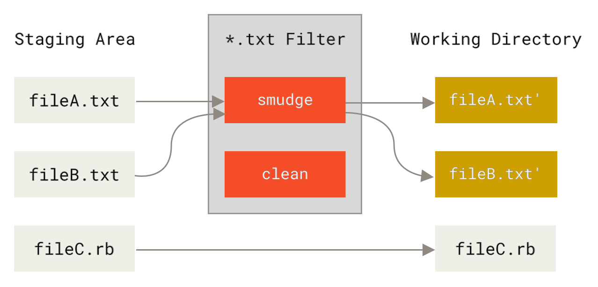
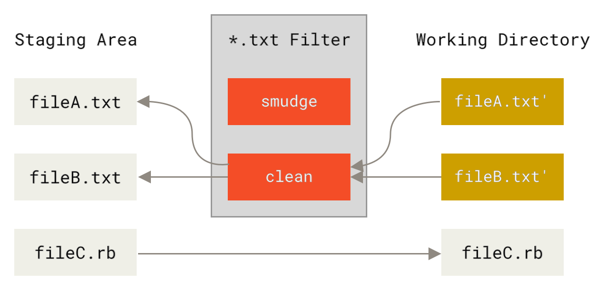
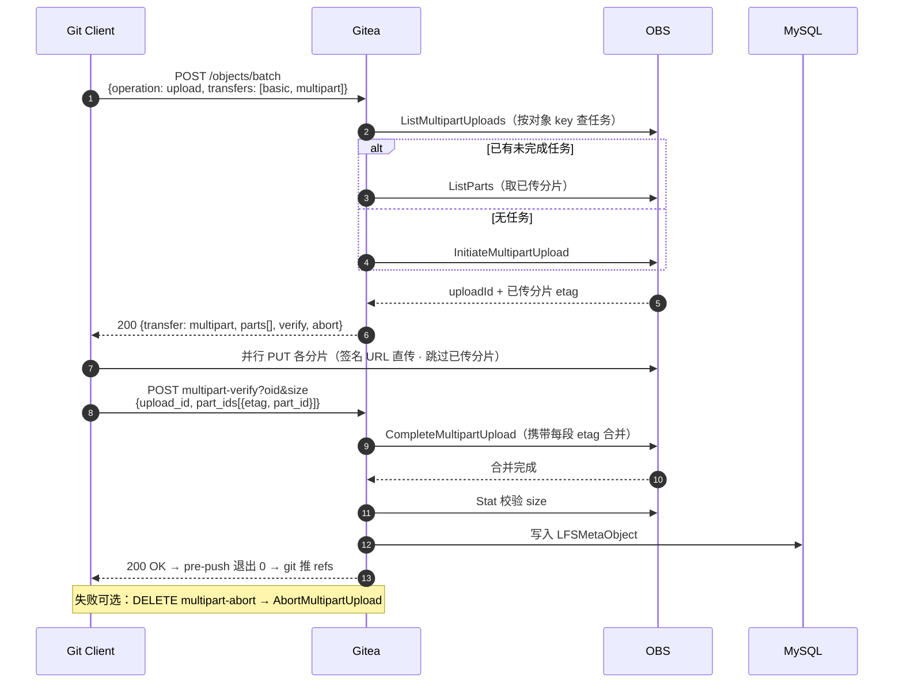
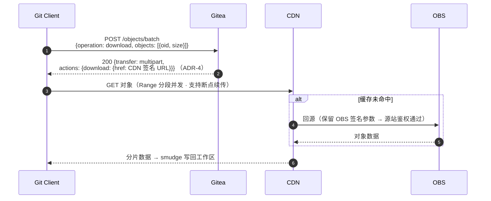

# Git Client 侧深度解析：从 .gitattributes 到后端 API

> **关联文档**：[模型存储与下载加速方案设计](model-storage-acceleration-design.md)、[分片上传深度解析：从 git push 到华为云 OBS](multipart-upload-deep-dive.md)（本文是其中第 5 节 ①③④ 环节的 git 本体视角展开）
> **立场**：本文站在 **git 自身的机制**（attributes / filter driver / hook）上，讲清 git-lfs client 如何挂接、以及客户端与后端 API 的完整交互。

---

## 1. 起点：一行 .gitattributes 的 git 语义

```
*.bin filter=lfs diff=lfs merge=lfs -text
```

`.gitattributes` 是 git 的**属性系统**配置文件：为匹配的文件路径设定属性，git 的各个子系统读取这些属性来决定行为。这行配置在 git 语义上声明了四件事：

| 属性 | git 语义 | 触发时机 |
|---|---|---|
| `filter=lfs` | 注册一个名为 `lfs` 的 **filter driver 对**（clean/smudge 两个方向） | 内容在"工作区 ↔ 暂存区"之间流转时 |
| `diff=lfs` | 注册名为 `lfs` 的 **diff driver**（外部 diff / textconv） | `git diff` / `git show` 比较文件内容时 |
| `merge=lfs` | 注册名为 `lfs` 的 **merge driver**（外部合并程序） | 分支合并遇到同一文件两侧都修改时 |
| `-text` | 声明文件为**二进制**：不做行尾转换（CRLF 等）、不按文本处理 | 所有文本处理路径 |

git 只负责"识别属性并调用对应的驱动程序"，**驱动程序的实现由 git 配置提供**——这正是 git-lfs 的挂接点：`git lfs install` 把 `lfs` 这个 driver 名解析成 git-lfs 自己实现的程序。

> git attributes 的匹配规则（简要）：同一路径可被多行 pattern 命中，**最后一个匹配的行生效**；pattern 带 `/` 时相对仓库根目录匹配，否则匹配任意层级。这也是 `.gitattributes` 能按目录/文件类型精细控制哪些文件走 LFS 的原因。

## 2. git 的 filter driver 协议：clean 与 smudge

filter driver 是 git 提供的一对**内容过滤器**，git 通过管道（STDIN → STDOUT）调用，方向相反：

<div align="center">
<a href="https://git-scm.com/book/en/v2/Customizing-Git-Git-Attributes"></a>
<p><em>图：smudge 过滤器在 checkout 时运行（来源：<a href="https://git-scm.com/book/en/v2/Customizing-Git-Git-Attributes">Pro Git Book, Git Attributes</a>，Figure 169）</em></p>
</div>

<div align="center">
<a href="https://git-scm.com/book/en/v2/Customizing-Git-Git-Attributes"></a>
<p><em>图：clean 过滤器在暂存时运行（来源：<a href="https://git-scm.com/book/en/v2/Customizing-Git-Git-Attributes">Pro Git Book, Git Attributes</a>，Figure 170）</em></p>
</div>

git 的配置项把 `lfs` 这个 filter 名解析成两条命令（`git lfs install` 写入，见 [multipart-upload-deep-dive.md §5①](multipart-upload-deep-dive.md)）：

```
[filter "lfs"]
    clean = git-lfs clean -- %f     # %f 是待处理文件的路径占位符
    smudge = git-lfs smudge -- %f
    required = true                 # 过滤器失败则整体操作失败
```

**协议契约**（git 与任意 filter 程序的约定）：

- **clean**：`git add` 暂存时，git 把工作区文件内容经 STDIN 交给程序，程序把"应存入仓库的内容"写到 STDOUT。git-lfs clean 的实际行为：边读边算 SHA-256 → 实体写入 `.git/lfs/objects/{oid}` → 输出**指针文件**（version/oid/size）——**仓库里存的是指针**；
- **smudge**：`git checkout`/`clone` 时，git 把仓库里的内容经 STDIN 交给程序，程序把"应写回工作区的内容"写到 STDOUT。git-lfs smudge 识别指针 → 查本地对象库（缺则向远端 batch API 下载）→ 输出**真实字节**；
- **required = true**：过滤器非零退出会中止整个 git 操作（不能静默产出损坏内容）；
- **filter-process（git 2.11+）**：长驻进程协议（pkt-line 帧格式），一次握手后批量处理多个文件，避免每次调用都启动进程——git-lfs 通过 `process = git-lfs filter-process` 使用该优化。

> Pro Git 对 filter 设计的一段提醒同样适用于 git-lfs："`.gitattributes` 随仓库分发，但 driver 程序不会——所以 filter 设计必须能优雅降级"（git-lfs 的对策：未安装 git-lfs 的用户 checkout 时 `required=true` 会直接报错提示，而不是悄悄拿到指针文件当真实内容）。

## 3. diff 与 merge 驱动

- **diff driver**（`diff.lfs.textconv = git-lfs textconv`）：git 比较两个版本前，先对两侧内容跑 textconv 转成文本。git-lfs 的实现把二进制内容转成可读的指针信息（oid/size）——`git diff` 不再输出二进制乱码，而是显示"这个文件的 oid 从 A 变成了 B"。Pro Git 的通用机制说明（[原文](https://git-scm.com/book/en/v2/Customizing-Git-Git-Attributes)）："告诉 Git 如何把二进制数据转成文本格式，再交给常规的 diff 比较"；
- **merge driver**（`merge.lfs.driver = git-lfs merge %O %A %B`）：三路合并时 git 传祖先版（%O）、当前版（%A）、另一分支版（%B）三个文件路径给程序，程序产出合并结果。对二进制模型文件没有"文本三路合并"可言，git-lfs 的 merge driver 按策略（ours/theirs 等）取一侧为结果，避免合出损坏文件。

## 4. pre-push hook 协议

`git push` 执行前，git 把**本次推送的 ref 对**通过 STDIN 逐行交给 pre-push 钩子：

```
<local ref> SP <local sha1> SP <remote ref> SP <remote sha1> LF
（可多行；sha1 为全零 40 位表示"将要删除"）
```

git-lfs 的 pre-push 实现（`git lfs pre-push`）：

1. 解析 ref 对，比较 `<local sha>` 与 `<remote sha>` 之间的 commit 差异；
2. 遍历差异中的 LFS 指针，收集 `{oid, size}` 清单；
3. 对每个对象执行 §5 的 batch 上传流程（实体从本地对象库读取）；
4. 全部成功 → 退出 0，git 继续推送 refs；任一失败 → 退出非 0，**push 整体中止**（保证远端不会出现"指针在、数据缺"的仓库状态）。

## 5. 与后端 API 的交互

### 5.1 官方总览

<div align="center">
<a href="https://git-lfs.com/"></a>
<p><em>图：Git LFS 工作机制总览（来源：<a href="https://git-lfs.com/">git-lfs.com</a> 官方站）</em></p>
</div>

客户端与后端的交互全部收敛在 **LFS API** 上（规范见 [Git LFS spec](https://github.com/git-lfs/git-lfs/blob/main/docs/api/README.md)）：服务发现、认证、Batch、文件传输四个部分。

### 5.2 服务发现与认证

- **服务发现**：LFS endpoint 由 git remote 推导——`https://git-server.com/foo/bar.git` → `https://git-server.com/foo/bar.git/info/lfs`（batch 地址 = endpoint + `/objects/batch`）；
- **认证**：http(s) 远程直接复用 git 凭据；ssh 远程则先执行 `ssh git@host git-lfs-authenticate <repo> <op>` 换取一次性 header（`Authorization: RemoteAuth <token>` + 过期时间）。本方案服务端在标准 Basic 之外补充了 `access_token` 认证方案（直接携带平台访问令牌）。

### 5.3 Batch API：唯一的协商入口

上传与下载共用一个 `POST /objects/batch`（见 [multipart-upload-deep-dive.md §5④](multipart-upload-deep-dive.md)），请求携带 `operation`（upload/download）、`transfers`（客户端支持的传输模式）、`objects[{oid,size}]`、`hash_algo`；响应为每个对象返回 `actions` 动作集——**客户端之后只执行动作，不做任何决策**。

### 5.4 上传：完整 API 交互时序

<div align="center">
<iframe src="https://whimsical.com/embed/mmMHWpYZ3VunAxsh7iABi" width="100%" height="300" style="border:none;border-radius:8px;" frameborder="0"></iframe>
<p><em>图：上传 API 交互时序（Whimsical 交互图：点击打开 <a href="https://whimsical.com/mmMHWpYZ3VunAxsh7iABi">Whimsical 在线版</a> 可编辑；GitHub 等不支持 iframe 的平台请直接点击链接）</em></p>
</div>

**文本示意（mermaid，GitHub 原生渲染）**：



**关键点**：

- 客户端对后端的调用只有 **3 个 HTTP 端点**：batch（协商）、multipart-verify（合并校验）、multipart-abort（可选取消）——其余全部是客户端与 OBS 之间的签名 URL 直传；
- **认证只发生在 batch 与 verify**：分片直传不携带用户凭据，只有 OBS 签名的时效授权（默认 24h）；
- 续传语义由 batch 的幂等协商承担：任何时刻重试 batch，服务端都会返回"剩余待传分片"清单（见 [multipart-upload-deep-dive.md §5⑤](multipart-upload-deep-dive.md)）。

### 5.5 下载：API 交互

下载的协议交互比上传简单（multipart 模式中 download 动作与 basic 一致，不返回 parts）：



下载侧的三个设计点（详见主文档 [ADR-4](model-storage-acceleration-design.md)、[ADR-9](model-storage-acceleration-design.md)）：

1. **href 是 CDN 域名改写的 OBS 签名 URL**——私有仓库对象安全走 CDN（边缘 `auth_key` 鉴权 + 源站 OBS 签名双重防护）；
2. **Range 分段与断点续传由 HTTP 层提供**——协议不需要为下载定义新动作；
3. **集群内下载时该 GET 经 Peer 代理**——代理层剥离签名参数做任务归一化，保证 P2P 缓存命中（`defaultFilter` + LFS 路径正则）。

## 6. 一次 push 的端到端串联

把 git 机制与 API 交互串成一条时间线（20GB 模型为例）：

```
git add          → clean 过滤器：实体入本地对象库，指针入 index
git commit       → 快照指针
git push         → pre-push 钩子：收集指针清单
                 → batch 协商（multipart）：拿到 parts[]/verify/abort
                 → 并行 PUT 分片直传 OBS（中途失败→重试 batch→只补缺失分片）
                 → multipart-verify：合并校验 + 元数据入库
                 → 钩子退出 0 → git 推送 refs
git checkout     → smudge 过滤器：指针→实体（缺失时走 batch download → CDN）
```

## 7. 参考资料

- [Pro Git Book — Git Attributes](https://git-scm.com/book/en/v2/Customizing-Git-Git-Attributes)（clean/smudge 图出处）
- [git-lfs.com](https://git-lfs.com/)（总览图出处）
- [Git LFS 规范](https://github.com/git-lfs/git-lfs/blob/main/docs/spec.md) / [Batch API](https://github.com/git-lfs/git-lfs/blob/main/docs/api/batch.md) / [LFS API 总览](https://github.com/git-lfs/git-lfs/blob/main/docs/api/README.md)
- [gitattributes(5)](https://git-scm.com/docs/gitattributes)（filter driver 协议）
- [multipart 提议](https://github.com/git-lfs/git-lfs/blob/main/docs/proposals/multipart_transfer_mode.md)
- 本仓库：[模型存储与下载加速方案设计](model-storage-acceleration-design.md)、[分片上传深度解析](multipart-upload-deep-dive.md)
