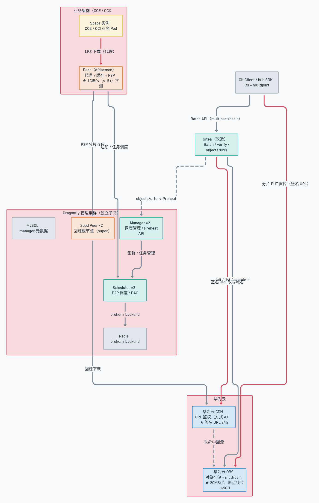
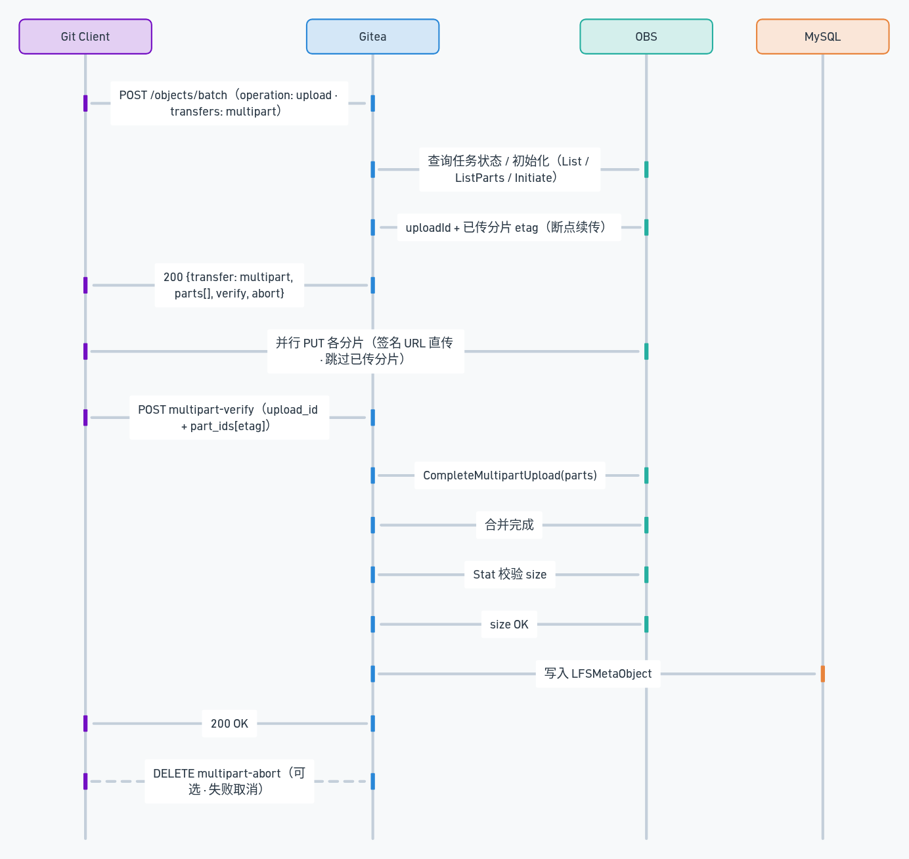
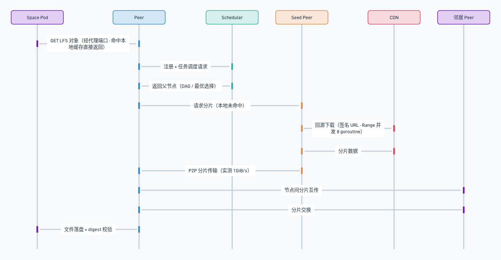
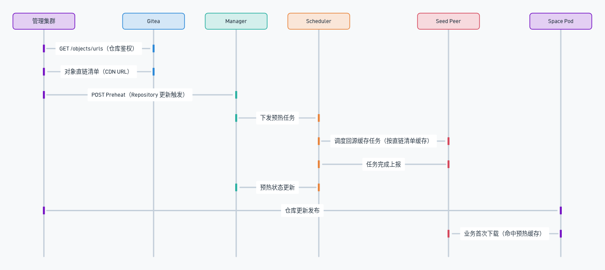
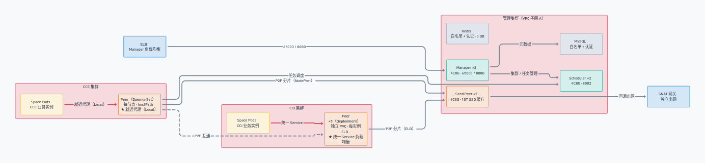

# 模型存储与下载加速方案设计

> **文档状态**：已采纳（Accepted）
> **适用读者**：模型平台开发、运维、平台架构师
> **关联仓库**：`openmerlin/gitea`（LFS multipart 实现）、`TommyLike/dragonfly-config`（集群配置）、`openmerlin/dragonfly-deploy`（生产部署脚本）
> **信息脱敏说明**：本文档中内网 IP、ELB 地址、内部域名均以 `<XXX>` 占位符代替真实值，端口、规格、版本、配置项保持真实。

---

## 1. 简介

### 1.1 目的

本文档描述模型平台"模型存储与下载加速"方案的完整设计，覆盖两大主题：

1. **模型上传与下载链路改造**：基于 Git LFS Multipart 扩展协议，在 Gitea 中实现大模型分片直传对象存储、断点续传与 CDN 下载加速；
2. **集群内大文件下载加速**：引入 Dragonfly 组件，为模型集群提供 proxy + cache + P2P 分发能力，并适配 CCE / CCI 等不同部署场景。

本文档回答三个问题：**为什么这样做**（挑战与业界参考）、**怎么做**（关键设计决策）、**带来了什么**（量化收益）。

### 1.2 范围

**覆盖范围**：

- Git LFS Multipart 传输协议扩展及其在 Gitea 中的实现（Batch API、分片上传、verify/abort、断点续传）
- 私有仓库对象经华为云 CDN 的鉴权下载加速方案
- Dragonfly 集群的组件选型、管理面部署、数据面（CCE/CCI）部署、客户端代理接入、缓存治理
- 预热（Preheat）机制所需的对象直链清单接口设计

**不覆盖范围**：

- Git LFS 协议本身的完整说明（仅引用规范）
- 镜像分发加速场景（本方案聚焦模型文件，Dragonfly 的 registry mirror 能力不在本文讨论）
- 模型平台其他子系统（调度、训练、推理）的设计

### 1.3 干系人与关注点

| 干系人 | 角色 | 关注点 |
|---|---|---|
| 模型开发者 | 通过 git / SDK 上传下载模型 | 上传下载速度、断点续传、大文件（>5GB）支持 |
| 平台开发 | 维护 Gitea / hub SDK | 协议兼容性、实现复杂度、上游演进风险 |
| 平台运维 | 维护 Dragonfly 集群与对象存储 | 高可用、容量规划、监控、故障隔离 |
| 集群用户 | 在 CCE / CCI 集群中拉取模型 | 集群内下载速度、对业务的无感接入 |

### 1.4 术语表

| 术语 | 含义 |
|---|---|
| `LFS` | Git Large File Storage，git 的大文件扩展机制 |
| `Pointer（指针文件）` | 大文件在仓库中实际存储的文本文件，记录 oid、size、LFS 规范版本 |
| `Batch API` | LFS 服务端指引客户端上传/下载的总入口 API（`/objects/batch`） |
| `transfer mode` | LFS 传输模式，官方仅 `basic`（单次 HTTP GET/PUT），`multipart` 为社区提议的分段模式 |
| `oid` | 对象唯一标识，默认 sha256 摘要 |
| `multipart upload` | 对象存储的分段上传能力（初始化/上传分段/合并/取消） |
| `presigned URL` | 对象存储生成的带签名临时 URL，客户端凭此直传/直下，无需服务端中转 |
| `OBS` | 华为云对象存储服务 |
| `CDN` | 内容分发网络，本方案指华为云 CDN |
| `Dragonfly` | 阿里开源、CNCF 毕业的基于 P2P 的文件分发加速系统 |
| `dfdaemon` | Dragonfly 的客户端守护进程（Peer / Seed Peer 均基于它） |
| `Peer` | 跟随业务集群部署的代理 + 缓存节点 |
| `Seed Peer` | P2P 集群的回源下载根节点（`type: super`） |
| `Scheduler` | P2P 调度器，构建下载 DAG、选择最优父节点 |
| `Manager` | 管理面：维护 Seed Peer/Scheduler 关联、异步任务（预热）、控制台 |
| `Preheat（预热）` | 任务在首次被请求前主动下载缓存到集群 |
| `CCE` | 华为云云容器引擎（自建 K8s 同理） |
| `CCI` | 华为云云容器实例（Serverless 容器） |
| `ELB` | 华为云弹性负载均衡 |

---

## 2. 背景与整体挑战

### 2.1 业务背景

模型平台以 Gitea 承载模型仓库（hub），模型文件（数 GB ~ 数百 GB）通过 Git LFS 上传下载；推理/训练集群（CCE、CCI、自建 K8s）中的 Space 实例在启动或更新时拉取 LFS 对象。模型的发布—消费链路是典型的"**一次上传、大量重复下载**"模式，对上传体验和集群内下载带宽都提出了高要求。

### 2.2 上传链路挑战

| # | 挑战 | 现状与影响 |
|---|---|---|
| C1 | **单连接上传慢** | 官方 git-lfs client 仅支持 `basic` transfer（单次 HTTP PUT），大模型上传吞吐受单连接限制，无法并行 |
| C2 | **>5GB 文件无法上传** | 华为云 OBS 对超过 5GB 的对象强制要求 multipart 上传；原生 lfs client 只支持 basic，导致 >5GB 模型直接无法上传 |
| C3 | **无断点续传** | basic 模式一次请求传完，网络抖动或中断即全量重传；GB 级文件重传成本极高 |
| C4 | **服务端中转带宽瓶颈** | Gitea 原生 LFS 上传经服务端中转（`MinioStorage.Save` 流式转发），所有上传流量穿越 Gitea，服务端出网带宽成为瓶颈 |
| C5 | **小文件过度开销** | multipart 有额外复杂度与开销，小文件一律分段反而变慢（规范中明确要求服务端对小对象回退 basic） |

### 2.3 下载链路挑战

| # | 挑战 | 现状与影响 |
|---|---|---|
| C6 | **私有仓库无法直接 CDN 加速** | 私有仓库对象需要鉴权；CDN 边缘节点无法感知仓库权限，直接公开不可接受 |
| C7 | **集群内重复下载浪费带宽** | 同一模型被集群内大量 Space 实例重复拉取，每次都回源 OBS/CDN，出口带宽线性增长、费用高 |
| C8 | **集群内拷贝本身不快** | 实测基线（见 §8.1）：CCI+EVS 跨节点拷贝 5G 文件约 249MB/s（24s），CCE+EVS 跨节点约 200~225MB/s（27~32s） |
| C9 | **客户端接入体验差** | git client 自身存在已知的下载卡死逻辑问题（调研记录），需要配置组合规避；hub SDK 尚不支持无感知配置代理 |
| C10 | **签名 URL 导致缓存失效** | OBS 签名 URL 每次生成都不同（`Expires`/`Signature` 变化），直接代理会导致同一对象被当作不同任务、缓存无法复用 |

### 2.4 共享文件存储替代方案的问题

调研中对比了共享文件存储方案（华为云 SFS Turbo、天翼云 SFS Turbo）作为集群内共享模型存储的替代路径，实测对比截图见调研文档（[Dragonfly 部署方案调研](https://tommylikeworkspace.notion.site/Dragonfly-b704d0215c1d4a21acb32db558936a55)）。共享存储的主要问题：

- 按容量 + 带宽双重计费，模型规模增长时成本线性上升；
- 带宽扩展有配额上限，无法像 P2P 一样随节点数横向扩展；
- 首次读取无缓存加速（数据需从存储读），且冷数据占用相同容量成本。

---

## 3. 业界参考

本章汇总方案调研阶段对相关技术的研究结论，详细调研过程见 [Git LFS Multi-Part 支持调研](https://tommylikeworkspace.notion.site/Git-LFS-Multi-Part-049a234815a740228ca5af838f978058)。

### 3.1 Git LFS 规范与 multipart 社区提议

**Git LFS 工作原理**（[官方 spec](https://github.com/git-lfs/git-lfs/blob/main/docs/spec.md)）：大文件以文本指针文件入库（`oid` + `size`），配合 git 的 clean/smudge 过滤器在暂存/检出时替换实际内容，pre-push 钩子触发真实上传。服务端提供三类能力：服务发现（LFS endpoint 跟随仓库 endpoint）、认证（`git-lfs-authenticate` + Basic Auth）、Batch API。

**Batch API**（[batch.md](https://github.com/git-lfs/git-lfs/blob/main/docs/api/batch.md)）是服务端指引客户端传输的总入口：请求携带 `operation`（upload/download）、`transfers`（客户端支持的传输模式）、`objects`（oid+size）、`hash_algo`；响应为每个对象返回 `actions`（download/upload/verify），其中 `href` 为真实传输地址、`expires_at` 为有效期。

**multipart 提议**（[multipart_transfer_mode.md](https://github.com/git-lfs/git-lfs/blob/main/docs/proposals/multipart_transfer_mode.md)）：官方 `basic` 之外，社区提议新增 `multipart` transfer mode，核心是复用云厂商对象存储的分段上传能力，其相对 basic 的改进：

| 改进点 | 说明 |
|---|---|
| 上传动作拆分 | `upload` 拆为 `parts[]`（每段独立 endpoint，含 `pos`/`size`），另有可选 `verify`、`abort` |
| 提高上传吞吐 | 多分段并行上传 |
| 降低网络错误影响 | 每个分段互不影响，暂停与恢复更方便 |
| 边创建边上传 | 无需等待整个文件就绪 |
| 摘要透传 | 部分存储后端要求分段上传携带摘要，通过 `want_digest` 声明、`Digest` 头回传 |
| 小对象回退 | 服务端对小于单个分片的对象可回退返回 `basic`，规避分段开销 |

### 3.2 Giftless：multipart 首个开源实现

[Giftless](https://giftless.datopian.com/en/latest/multipart-spec.html)（Python）是首个实现 multipart 的 LFS 服务端，其实现要点对本方案有直接参考价值：

- **Client 侧仅提供 transfer agent**：通过 git-lfs 的 `custom-transfer` 机制挂接官方 client，无需 fork 官方 client；
- **Server 侧三种 adapter**：`basic`（官方一致）、`streaming`（流式）、`multipart`（当前仅 Azure 后端支持）；
- **续传设计**：每次 batch upload 请求都会检查已上传的分段，只返回需要补充上传的 part 信息；
- **commit 动作**：Azure 分片上传后需主动调 commit 接口合并，giftless 新增 `commit` action（官方提议中建议将 commit 语义合入 `verify` action）；
- **取消支持**：分段上传支持取消操作；
- 下载侧 giftless 仅基于 `Content-Range` 做分段下载，**不支持断点续传**。

### 3.3 HuggingFace 实践

HuggingFace 未开源其服务端，但客户端 [huggingface_hub](https://github.com/huggingface/huggingface_hub) 的实现有很高的参考价值：

| 观察点 | 结论 |
|---|---|
| Batch 协议 | 部分遵守 LFS batch API 规范并支持 multipart，请求中 `transfers: ["basic", "multipart"]` |
| 返回结构压缩 | 不按标准 parts 数组返回，而是 `chunk_size` + 以编号为 key 的分片 URL header（`00001`/`00002`…），收益是响应体积更小；代价是非标准、需定制 client |
| >5GB 支持 | 通过 `huggingface-cli lfs-enable-largefiles` + `lfs-multipart-upload` 两个命令注册 custom transfer agent 实现 |
| 下载 | 支持分段下载与断点续传（依托分段能力） |
| 传输性能 | 引入基于 Rust/Tokio 的 `hf_transfer` 库，可 **2 倍以上**提升传输性能 |
| 指针文件 | 上传完成后按 LFS SPEC V1 创建指针文件，与 git 生态兼容 |

### 3.4 Gitea 原生实现的局限

Gitea 原生支持 LFS（client/server 均自实现），但有明显局限：

| 局限 | 说明 |
|---|---|
| Client 仅支持 basic | 下载不支持分段与断点续传 |
| Server 不支持 multipart | Batch 默认返回 `transfer=basic` |
| 上传需中转 | 文件先到 Gitea 服务端再写云存储，无法直传 |
| 存储抽象屏蔽差异 | 基于 MinIO 的 `ObjectStorage` 接口屏蔽了底层差异（要求 S3 兼容），但 **MinIO 无法感知各云厂商 Multipart 的具体实现**——对比之下 giftless 可以为每个具体后端（如 Azure）单独配置 storage |

### 3.5 集群内 P2P 分发方案对比

| 方案 | 定位 | 评估结论 |
|---|---|---|
| **Dragonfly**（[d7y.io](https://github.com/dragonflyoss/dragonfly)） | 阿里开源（2017 开源、2018 进 CNCF Sandbox、2020 进 Incubation、**2026 年 1 月 CNCF 毕业**）的 P2P 文件分发系统 | **选用**。理由：① 生产验证充分（阿里/蚂蚁内部支持每天数千万次容器启动、节省最高 90% 存储带宽；AI 模型权重百 TB 级分钟级分发到数百节点）；② 组件齐全（Manager/Scheduler/Seed Peer/dfdaemon），支持 proxy 模式对任意 HTTP 下载透明加速；③ 提供 Preheat 预热 API，支持"模型发布即缓存"；④ 活跃社区（CNCF 毕业 + 安全审计） |
| Kraken（Uber） | P2P Docker registry | 不选。聚焦镜像分发场景，无通用 HTTP 代理与预热 API；社区活跃度与生态远弱于 Dragonfly |
| peerpie | OCI artifact P2P daemon | 不选。范围更窄，仅覆盖 OCI artifact 场景 |
| SFS Turbo 共享存储 | 华为云/天翼云共享文件存储 | 不选（见 §2.4）：按容量+带宽计费、带宽扩展有上限、无 P2P 横向扩展能力 |

### 3.6 调研结论

1. **上传**：遵循社区 multipart 提议（而非 HF 的压缩私有格式），在 Gitea 服务端实现，客户端获得标准兼容（官方 client 声明支持 multipart 即可接入），分片直传对象存储消除中转瓶颈；
2. **下载**：私有仓库对象走"签名 URL + CDN 鉴权回源"方案；集群内引入 Dragonfly 做 proxy+cache+P2P 加速；
3. **客户端**：不改 git-lfs 源码，通过官方 client 的 multipart 支持 + 代理配置组合接入（参见 ADR-9）。

---

## 4. 总体架构

### 4.1 架构总览

<div align="center">
<a href="https://whimsical.com/ALQXAJfBYgokJCd3ZbJTeZ"></a>
<iframe src="https://whimsical.com/embed/ALQXAJfBYgokJCd3ZbJTeZ" width="100%" height="300" style="border:none;border-radius:8px;" frameborder="0"></iframe>
<p><em>图 1：模型存储与下载加速总体架构（Whimsical 交互图：点击图片打开 <a href="https://whimsical.com/ALQXAJfBYgokJCd3ZbJTeZ">Whimsical 在线版</a> 可编辑；下方 iframe 为嵌入预览，GitHub 等不支持 iframe 的平台请直接点击图片）</em></p>
</div>

**图 1 要点**：

- 左侧为**上传链路**：git client / hub SDK 通过 LFS Batch API 从 Gitea 获取分片签名 URL，**分片并行直传 OBS**（绕过 Gitea 中转），verify 后由 Gitea 触发分片合并；下载时 Gitea 返回改写为 CDN 域名的签名 URL；
- 右侧为**集群内加速链路**：业务集群（CCE/CCI）内的 Peer（dfdaemon）作为本地代理缓存节点，与 Scheduler、Seed Peer 构成 P2P 网络；Space Pod 的 LFS 下载经 Peer 代理，命中本地/邻居缓存，未命中时由 Seed Peer 回源 CDN 后分发给集群；
- 两个链路的结合点是 **Preheat 预热**（ADR-5/§6.3）：Gitea 的对象直链清单接口为 Dragonfly 预热任务提供源 URL。

### 4.2 组件职责

| 组件 | 部署位置 | 职责 |
|---|---|---|
| Gitea（改造） | hub 集群 | LFS Batch API（multipart 分流）、分片签名 URL 生成、verify/commit、CDN 直链、`/objects/urls` 直链清单 |
| OBS | 华为云 | 模型对象最终存储；multipart 任务状态（init/list/complete/abort） |
| CDN | 华为云 | 私有仓库对象的鉴权加速下载（URL 鉴权方式 A） |
| Dragonfly Manager | 管理集群 | Seed Peer/Scheduler 关联维护、异步任务（Preheat）、为 dfdaemon 筛选 Scheduler、可视化控制台 |
| Dragonfly Scheduler | 管理集群 | 基于规则/ML 的 P2P 节点调度、下载 DAG 构建、异常节点剔除 |
| Seed Peer | 管理集群 | 回源下载根节点（super），承载预热任务缓存 |
| Peer（dfdaemon） | CCE DaemonSet / CCI Deployment | 业务集群内代理 + 缓存 + P2P 节点 |

---

## 5. 关键设计决策（ADR）

> 本章所有 ADR 状态均为**已采纳（Accepted）**。每条 ADR 以「问题 → 决策 → 备选 → 权衡」四段式呈现，后文交叉引用 ADR 编号。

### ADR-1：LFS Batch API 扩展 multipart transfer 协议

**问题**：原生 `basic` transfer 单连接、无断点续传、>5GB 受限（C1/C2/C3）。需要在不破坏官方 client 兼容性的前提下扩展传输协议。

**决策**：遵循社区 multipart 提议（giftless 规范）在 Gitea 中扩展 Batch API：

- 请求侧：客户端在 `transfers` 中声明 `multipart`；Gitea 通过 `BatchHandlerAdapter` 分流——声明 multipart 走 `MultipartBatchHandler`，否则走原生 `BatchHandler`（对老客户端完全兼容）；
- 上传响应：`actions` 返回 `parts[]`（每段：签名 `href`、`pos` 起始偏移、`size`、`method=PUT`、`part_id`、`expires_in`）+ `verify`（含 `aggregation_params`，见 ADR-3）+ `abort`（`method=DELETE`）；
- 下载响应：`actions` 返回单个 `download`，指向 CDN 域名改写后的签名 URL（ADR-4）；
- 鉴权：新增 `access_token` 认证方案（`parseToken` 支持 `access_token` 前缀），batch 请求可直接携带访问令牌。

**备选**：① 照搬 HuggingFace 压缩返回格式（`chunk_size` + 编号 header）——响应更小，但非标准、强制定制 client，牺牲生态兼容；② 自研私有协议——彻底破坏 git 生态兼容性。

**权衡**：牺牲少量响应体积与新增 verify/abort 语义的客户端处理成本，换取**标准兼容**——官方 git-lfs client、HF client、自研 SDK 均可按同一协议接入；协议与社区提议对齐，未来上游合入后迁移成本低。

### ADR-2：分片策略与对象存储直传

**问题**：分片多大合适？basic 与 multipart 如何选择？如何消除 Gitea 中转带宽瓶颈（C4）？

**决策**：

1. **固定分片大小 20MB**（`multipart_chunk_size = 20000000`），按文件大小生成分片清单；
2. **大小阈值决策**（设计）：<100MB 强制 basic（规避分段开销，对应 C5）；>5GB 强制 multipart（规避 OBS 单对象上传限制，对应 C2）；其余优先 multipart。实现上以客户端声明的 transfers 分流，服务端在 multipart 分支内按此策略生成响应；
3. **分片直传 OBS**：每个分片返回华为云 OBS **presigned PUT URL**（`CreateSignedUrl`，`partNumber` + `uploadId` 查询参数），客户端分片**直接上传到 OBS**，Gitea 服务端不承载任何文件数据流——中转带宽占用降为 0；
4. **签名时效**：分片 URL 默认 1800s（30min），后调整为 86400s（24h，见下载侧统一），过期需重新发起 batch 请求（续传友好，见 ADR-3）。

**备选**：① 按文件大小动态计算分片大小——复杂度高、客户端处理逻辑复杂；② 保留服务端中转上传——带宽瓶颈不解决。

**权衡**：固定 20MB 对大文件分片数偏多（50GB → 2560 片，batch 响应体积随之增大），换取实现简单、并发粒度可控、与 HF 的 16MB 量级一致（实践背书）。

### ADR-3：断点续传与分段任务生命周期管理

**问题**：模型上传 GB 级起步，网络抖动重传代价大；服务端/客户端中断后如何恢复；多任务并存时的状态一致性（C3）。

**决策**（实现在 `HWCloudStorage.GenerateMultipartParts` / `CommitUpload`，对应 Notion 方案中的 `GetUploadAction` / `CommitUpload`）：

1. **每次 batch 请求先查 OBS 任务状态**：
   - `ListMultipartUploads`（按对象 key 前缀）发现 **>1 个未完成任务 → 全部 abort 后重新初始化**（清理脏状态）；
   - 恰好 **1 个未完成任务 → `ListParts` 取已传分段清单**，对"已传且长度匹配"的分段直接返回其 `etag`（不带上传 URL），客户端跳过已传分段——**断点续传对客户端完全透明**；
   - **0 个 → `InitiateMultipartUpload`** 创建新任务；
2. **verify 即 commit**：客户端上传完全部分段后调用 `multipart-verify?oid=&size=`，请求体携带 `{upload_id, part_ids: [{etag, part_id}]}`（`aggregation_params` 声明的聚合语义，与华为云"合并时需指明每段 Etag"的要求对齐）；服务端 `CompleteMultipartUpload` 合并 → `Stat` 校验大小 → 写 `LFSMetaObject` 入库；
3. **幂等处理**：合并时 `NoSuchUpload` 错误忽略（重复 verify 容忍）；对象已存在时 verify 直接返回 200。

**备选**：① 客户端本地记录上传状态——跨客户端/跨机器不共享，不可靠；② 不做恢复——实现简单，但用户体验不可接受（GB 级全量重传）。

**权衡**：服务端依赖 OBS 的任务列表/分段列表 API 维护状态机，增加实现复杂度；换取**官方 client 零修改即可获得断点续传**——失败重试成本从 O(N) 降到 O(未完成分片数)。

### ADR-4：私有仓库对象的 CDN 下载加速

**问题**：CDN 无法感知私有仓库权限（C6），但集群外/首次下载的场景又需要 CDN 加速。

**决策**：

1. **签名 URL 改写 CDN 域名**：下载 action 的 URL 生成为 OBS 签名 URL 后，将 host 改写为 CDN 域名（`bucketDomain`，强制 https），**保留全部签名查询参数**——CDN 未命中回源 OBS 时，签名在源站依然有效（OBS 侧校验通过）；
2. **CDN 侧 URL 鉴权（华为云方式 A）**：CDN 开启鉴权配置（访问鉴权 key + 有效期 + 摘要算法 sha256/md5），后端生成临时 URL 时计算 `auth_key`：
   ```
   HashValue = sha256(资源路径 + "-" + 当前时间戳 + "-" + 随机数 + "-" + 用户ID + "-" + 私有密钥)
   final_url = https://<CDN_DOMAIN>/<path>?auth_key=<timestamp>-<rand>-<uid>-<hash>
   ```
3. **双重防护**：CDN 边缘校验 `auth_key`，源站校验 OBS 签名参数——任一环节 token 过期/伪造即拒绝访问；签名默认有效期 24h。

**备选**：① CDN 资源全量公开——安全不可接受（私有模型泄露）；② 回源经 Gitea 鉴权中转——服务端带宽瓶颈回归（同 C4）。

**权衡**：牺牲 URL 的永久有效性（有时效、有随机数防重放），换取安全与加速兼得；签名 URL 带时效也天然限定了泄露后的暴露窗口。

### ADR-5：对象直链清单接口（预热支撑）

**问题**：Dragonfly 预热任务需要对象的源 URL 清单（ADR-6/§6.3），逐个仓库人工获取不现实；直接给预热组件对象存储列举权限则越权面过大。

**决策**：Gitea 新增 `GET /{owner}/{repo}.git/info/lfs/objects/urls` 接口：

1. 复用 Gitea 仓库鉴权体系（与 batch API 同一认证链路，`ServeDirect` 未开启时拒绝）；
2. 枚举仓库全部 `LFSMetaObject`，对每个已存在对象生成直链 URL（经 ADR-4 的 CDN 域名改写），跳过存储中不存在的对象（记 warn 日志）；
3. 首版**不做分页**（明确记录为已知限制），响应 `{objects: [{oid, size, url}]}`。

**备选**：① 预热任务直接持 OBS AK/SK 列举 bucket——越权面大、审计难；② 独立 URL 索引服务——额外组件与同步成本。

**权衡**：大仓库全量枚举响应体积大、接口耗时随对象数线性增长，换取权限收敛在 Gitea 认证体系内、实现简单；预热调用频率低（每仓库更新触发一次），可接受。

### ADR-6：集群内加速组件选型 Dragonfly

**问题**：集群内重复下载浪费出口带宽（C7），基线跨节点拷贝仅 200~250MB/s（C8），共享存储成本高（§2.4）。

**决策**：引入 **Dragonfly 2.1.32** 作为集群内加速组件，利用其三类能力：

1. **proxy 模式**：dfdaemon 作为 HTTP 代理监听（CCE 32002 / CCI 65001 / 管理节点 65001），业务 Pod 的 LFS 下载经配置路由到本机/本集群 Peer；
2. **P2P 分发**：Scheduler 构建下载 DAG、选择最优父节点；节点间分片互传，回源收敛到 Seed Peer；
3. **Preheat 预热**：Manager 提供 Preheat API，模型发布后主动缓存（§6.3）。

**备选**：① Kraken——聚焦 Docker 镜像 P2P，无通用代理与预热能力，生态弱（详见 §3.5）；② peerpie——仅 OCI artifact；③ SFS Turbo 共享存储——成本与扩展性劣势（§2.4）；④ 纯 CDN 加带宽——成本随下载量线性增长，不解决集群内重复流量。

**权衡**：引入 Manager/Scheduler/SeedPeer/Peer 四类角色的运维复杂度，换取集群内下载 4~5 倍提速（§8.1）与出口带宽大幅节省（§8.4）；Dragonfly 的 CNCF 毕业状态（2026.1）与阿里/蚂蚁生产实践降低了可持续性风险。

### ADR-7：管理面独立部署与高可用

**问题**：管理组件（Manager/Scheduler/SeedPeer）与业务集群混部会造成资源争抢与故障域耦合；单实例存在单点故障。

**决策**：

1. **网络隔离**：管理节点与 Space 业务集群隔开——相同 VPC、不同子网；管理节点配置**独立 SNAT**，避免回源入站流量对业务应用造成影响；
2. **负载均衡**：Manager 前置 ELB（gRPC 65003 与 console 8080 分别暴露），`advertiseIP` 指向 ELB 地址，Scheduler/SeedPeer/Peer 均经 ELB 动态发现 Manager；
3. **高可用**：Manager / Scheduler / Seed Peer 均**双实例（≥2）**，前期基于 VM + Docker Compose + systemd（`restart: always` + healthcheck 自拉起），有条件时迁移托管 CCE；
4. **依赖外部化**：MySQL + Redis 使用云托管实例（白名单 + 用户认证，Redis 分 3 个 DB：cache/broker/backend）；
5. **规格**（参考阿里内部部署参数，版本统一 2.1.32）：

| 组件 | CPU | 内存 | 磁盘 | 关键端口 |
|---|---|---|---|---|
| Manager | 4C | 8GiB | 100GiB（日志） | 65003 gRPC / 8080 console |
| Scheduler | 4C | 8GiB | 100GiB（日志） | 8002 gRPC |
| Seed Peer | 4C | 8GiB | **10T 高速 SSD**（缓存） | 65006 下载 / 65007 proxy / 65008 上传 |

**备选**：① 管理组件混部到业务集群——资源争抢、故障域耦合；② 一步到位托管 K8s 部署——落地慢，前期 VM+Compose 更快且可观测性可控。

**权衡**：增加独立子网/SNAT/ELB 的配置与维护成本，换取故障隔离与入站流量可控。

### ADR-8：数据面 Peer 分场景部署（CCE vs CCI）

**问题**：CCE（节点可控、可 DaemonSet 落盘）与 CCI（Serverless，无宿主机视角、无法 DaemonSet + hostPath）环境约束不同，需要差异化部署策略。

**决策**：

**CCE / 自建集群**（`peer/cce/`）：

- **DaemonSet** 部署 Peer（每节点一个，`hostPath` 落盘到节点本地盘）；initContainer 将节点 IP 注入 `advertiseIP`；
- **ClusterIP Service 设置 `internalTrafficPolicy: Local`**（K8s ≥1.26）：Space Pod 经该 Service 访问**同节点** Peer Pod，就近代理；
- **NodePort Service** 暴露 32001/32002/32003，打通跨 VPC 的 Peer 间 P2P 互联。

**CCI 集群**（`peer/cci/`）：

- **5 个 Deployment**（每副本 1），每个使用**独立 PVC 卷**——规避单 Pod 网络/存储带宽上限；
- **统一 ClusterIP Service** 对全部 Peer 实例负载均衡，CCI 内 Space Pod 经该 Service 走任一 Peer 代理（不能保证同节点，实测跨节点速度可接受，见 §8.1）；
- **每实例绑定独立 ELB LoadBalancer Service**（`advertiseIP` 指向 ELB IP），把 Peer Pod 暴露到整个 VPC——非 CCI 节点也可与此 Peer 建立 P2P 连接，最大程度复用缓存节点。

**备选**：① CCI 多实例共享 PVC——带宽争抢与数据冲突；② CCE 用 Deployment 集中部署——无法就近代理、热点集中单点。

**权衡**：CCI 场景牺牲"同节点命中"保证（以统一 Service 负载均衡替代），换取 Serverless 环境可落地；ELB 每实例绑定带来额外费用，换取跨 VPC P2P 互通与缓存复用。

### ADR-9：客户端代理接入与任务唯一性

**问题**：如何让 git client / hub SDK 以最小成本接入 Peer 代理（C9）；签名 URL 每次不同会导致同一对象缓存失效（C10）；如何避免代理缓存无关流量。

**决策**：

1. **git client 三件套配置**（对官方 client 零修改）：
   ```bash
   git config http.proxy http://127.0.0.1:65001                     # 走本机/本集群 Peer 代理端口
   git config --global url.http://<HUB_DOMAIN>/.insteadOf https://<HUB_DOMAIN>/  # https→http 便于代理劫持
   git config --global lfs.transfer.enablehrefrewrite true          # 允许改写下载 href
   ```
   > 注：git client 存在已知的下载卡死逻辑问题（调研记录），上述组合可规避；代理端口以实际部署为准（CCE 32002 / CCI 65001 / 管理节点 65001）。
2. **hub SDK 无感代理**：通过环境变量支持将 LFS 请求指向代理（参考 git proxy 逻辑，已完成）；如需 https 劫持可启用 dfdaemon 的 `hijackHTTPS` 能力（默认关闭）；
3. **只缓存 LFS 对象**：Peer 配置 `proxies.regx` 精确匹配 LFS 对象 URL 路径（`/lfs/\w{2}/\w{2}/\w{60}\?`，即 OID 三段式路径），避免缓存无关文件；
4. **任务唯一性**：`defaultFilter` 移除 `Expires`/`Signature`/`response-content-disposition` 等签名相关查询参数——同一对象的多次签名 URL 映射到**同一个 P2P 任务**，缓存可复用（直接解决 C10）。

**备选**：① fork 修改 git-lfs 源码——维护成本高、上游分裂风险；② 仅支持 http 场景——放弃 https 下载加速。

**权衡**：代理配置需要用户侧一次性 git config（或由平台初始化脚本注入），换取上游 client 零修改、协议零破坏。

### ADR-10：缓存容量与生命周期治理

**问题**：Seed Peer 10T / Peer 1T 缓存打满怎么办？过期数据如何回收？升级时缓存是否保留？

**决策**（均落在 `dfget.yaml` / `seed-peer.yaml` 配置中）：

| 治理项 | 配置 | 值 |
|---|---|---|
| 任务无访问过期 | `storage.taskExpireTime` | 48h 后 GC |
| 磁盘配额 GC | `storage.diskGCThreshold` / `diskGCThresholdPercent` | 9216Gi（10T 的 90%）双阈值，超限回收最老任务 |
| 升级保留缓存 | `keepStorage` | true |
| 同任务存储复用 | `storage.multiplex` | true |
| 调度侧节点回收 | `scheduler.gc.peerTTL` / `hostTTL` | 24h / 1h |
| 回源并发控制 | `download.concurrent` | 阈值 20M / 速度 4M 起、8 goroutine |

**备选**：① 不做 GC——磁盘打满影响集群可用性；② 定时全量清理——误伤热数据、缓存命中率骤降。

**权衡**：48h 过期策略下低频模型可能回源重下，换取容量可控与热数据保护；9216Gi 阈值与 10T 盘匹配，为元数据与日志预留 10% 空间。

> 📖 **延伸阅读**：[服务端关键设计解析](server-side-key-designs.md) —— 按"做错了会怎样"的关键度梯队，展开任务归一化、续传状态外置、etag 透传、verify 幂等四个服务端设计的实现细节。

---

## 6. 运行时视图

### 6.1 模型上传时序（multipart）

<div align="center">
<a href="https://whimsical.com/ACw6GL1ggeAvGhdeoQCrMb"></a>
<iframe src="https://whimsical.com/embed/ACw6GL1ggeAvGhdeoQCrMb" width="100%" height="300" style="border:none;border-radius:8px;" frameborder="0"></iframe>
<p><em>图 2：multipart 上传时序（Whimsical 交互图：点击图片打开 <a href="https://whimsical.com/ACw6GL1ggeAvGhdeoQCrMb">Whimsical 在线版</a> 可编辑；下方 iframe 为嵌入预览，GitHub 等不支持 iframe 的平台请直接点击图片）</em></p>
</div>

**图 2 关键点**：

- 步骤 3/4 体现 ADR-3 的续传设计：任务存在时返回已传分片 etag，客户端跳过已传分片；
- 步骤 6 的分片 PUT 全部直传 OBS（ADR-2），Gitea 只承载 batch/verify 控制面流量；
- 步骤 8 的 verify 即 commit（ADR-3），服务端合并后校验大小并写元数据。

> 📖 **延伸阅读**：[分片上传深度解析：从 git push 到华为云 OBS](multipart-upload-deep-dive.md) —— 以一次真实的 20GB 模型 push 为线索，逐环节拆解上传链路的组件与关键考量点。

### 6.2 集群内 P2P 下载时序

<div align="center">
<a href="https://whimsical.com/DGc7bHNenoM4hjV41ihHYK"></a>
<iframe src="https://whimsical.com/embed/DGc7bHNenoM4hjV41ihHYK" width="100%" height="300" style="border:none;border-radius:8px;" frameborder="0"></iframe>
<p><em>图 3：集群内 P2P 下载时序（Whimsical 交互图：点击图片打开 <a href="https://whimsical.com/DGc7bHNenoM4hjV41ihHYK">Whimsical 在线版</a> 可编辑；下方 iframe 为嵌入预览，GitHub 等不支持 iframe 的平台请直接点击图片）</em></p>
</div>

**图 3 关键点**：

- Space Pod 的下载经 Peer 代理透明接入（ADR-9），对业务无感；
- 首次请求由 Seed Peer 回源 CDN（签名 URL 直取，ADR-4），后续节点从 P2P 网络分片互传；
- Scheduler 负责 DAG 构建与父节点选择，异常节点自动剔除。

### 6.3 预热时序（Preheat）

<div align="center">
<a href="https://whimsical.com/7QRsY6z1R7smVPPVowztvz"></a>
<iframe src="https://whimsical.com/embed/7QRsY6z1R7smVPPVowztvz" width="100%" height="300" style="border:none;border-radius:8px;" frameborder="0"></iframe>
<p><em>图 4：预热时序（Whimsical 交互图：点击图片打开 <a href="https://whimsical.com/7QRsY6z1R7smVPPVowztvz">Whimsical 在线版</a> 可编辑；下方 iframe 为嵌入预览，GitHub 等不支持 iframe 的平台请直接点击图片）</em></p>
</div>

**图 4 关键点**：

- 触发方为 OpenMind 管理集群（每次 Repository 更新触发一次 Preheat 任务，对应 ADR-5 接口的消费方）；
- 直链清单来自 Gitea `/objects/urls`（权限收敛在 Gitea 认证体系内）；
- 预热完成后，业务集群首个下载请求直接命中 Seed Peer 缓存，**首次下载即加速**；
- 已知限制：Dragonfly 当前不持久化任务信息（调研记录），预热任务对账能力待补（见 §9）。

---

## 7. 部署模型

### 7.1 部署拓扑

<div align="center">
<a href="https://whimsical.com/2GtouQzSR6ZMLAiJVc7LLY"></a>
<iframe src="https://whimsical.com/embed/2GtouQzSR6ZMLAiJVc7LLY" width="100%" height="300" style="border:none;border-radius:8px;" frameborder="0"></iframe>
<p><em>图 5：生产部署拓扑（Whimsical 交互图：点击图片打开 <a href="https://whimsical.com/2GtouQzSR6ZMLAiJVc7LLY">Whimsical 在线版</a> 可编辑；下方 iframe 为嵌入预览，GitHub 等不支持 iframe 的平台请直接点击图片）</em></p>
</div>

**图 5 关键点**：

- 管理集群 3 个 VM 节点（8C16G），每节点 Docker Compose 部署 manager/scheduler/seed-peer/dfdaemon 四容器，systemd 托管；MySQL/Redis 为托管实例；Manager 前置 ELB；
- CCE 集群：DaemonSet 每节点一个 Peer（hostPath 落盘），ClusterIP（`internalTrafficPolicy: Local`）+ NodePort 双 Service；
- CCI 集群：5 个 Deployment（独立 PVC）+ 统一 ClusterIP Service + 每实例 ELB LoadBalancer；
- 跨集群 P2P 互通：CCE NodePort / CCI ELB 分别暴露 Peer 端口到 VPC。

### 7.2 组件规格与端口

| 组件 | 版本 | 规格 | 端口 | 部署形态 |
|---|---|---|---|---|
| Manager | 2.1.32 | 4C8G / 100G | 65003 gRPC、8080 console | VM + Compose，×2，ELB 前置 |
| Scheduler | 2.1.32 | 4C8G / 100G | 8002 gRPC | VM + Compose，×2 |
| Seed Peer | 2.1.32 | 4C8G / 10T SSD | 65006 下载、65007 proxy、65008 上传 | VM + Compose，×2 |
| Peer（CCE） | 2.1.32 | 2C4G / 节点本地盘 | 32001 下载、32002 proxy、32003 上传 | DaemonSet，每节点 1 个 |
| Peer（CCI） | 2.1.32 | 2C4G / 独立 PVC | 65000 下载、65001 proxy、65002 上传 | Deployment ×5，每实例 ELB |
| Redis | 托管 | 最小规格 | — | 白名单 + 认证，3 个 DB |
| MySQL | 托管 | 最小规格 | — | 白名单 + 认证 |

### 7.3 关键部署配置

- **管理节点磁盘布局**：`/data1`（100G 普通 SSD）承载 manager/scheduler 的日志与 home；`/data2`（10T 高速 SSD）承载 seed-peer/peer 的缓存数据（pieces）——缓存与日志分离，避免 GC 干扰；
- **Compose 网络隔离**：每个节点的 compose 配置独立子网（如 `172.30.0.0/16`），避免多节点 IP 冲突；
- **反向代理证书**：cce/cci 集群的反向代理证书通过 secret 注入（`tls.crt`/`tls.key`）；
- **gRPC TLS**：`tlsPolicy: prefer`（服务端兼容明文/密文，分两步升级），首期 `autoIssueCert: false`；
- **配置即代码**：全部集群配置按 git 仓库管理（`dragonfly-config` / `dragonfly-deploy`），部署前替换密码与证书。

---

## 8. 收益

> 标注约定：〔实测〕= 调研/测试阶段真实测得的数据；〔推算〕= 基于部署规模与合理假设的估算，明确标注假设条件。

### 8.1 效率收益

**集群内下载〔实测〕**：

| 场景 | 基线（无加速） | Dragonfly 加速后 | 提升 |
|---|---|---|---|
| CCI+EVS 跨节点拷贝 5G 文件 | 249MB/s（24s） | 跨节点单次请求 **1GiB/s**（高速 SSD 约 2s 落盘） | **约 4~5 倍** |
| CCE+EVS 跨节点拷贝 5G 文件 | 197~225MB/s（27~32s） | 同上 | **约 4~5 倍** |

> 加速后数据为单节点部署 Dragonfly 的非并发场景测试结果；并发场景下 P2P 分片互传的聚合吞吐还可进一步放大。

**上传链路〔实测 + 推算〕**：

- 〔实测〕分片直传 OBS（ADR-2）：Gitea 服务端文件流转发流量**降为 0**，仅承载 batch/verify 控制面请求；
- 〔实测〕>5GB 模型可上传（原生 client 受 OBS 5GB multipart 强制限制无法上传）；
- 〔推算〕并行分片上传：设客户端上行带宽上限为 B、并发分片数为 N，总吞吐 ≈ min(N × 单连接吞吐, B)。以 8 并发、单连接满带宽场景为例，上传时间可缩短至串行时间的 1/8（受客户端上行带宽上限约束）；
- 〔推算〕断点续传（ADR-3）：上传中断重试成本从全量 O(文件大小) 降为 O(未完成分片)。以 20GB 文件、已传 80% 时中断为例，重传量从 20GB 降为 4GB（节省 80%）。

### 8.2 安全收益

- **私有对象双重鉴权**（ADR-4）：CDN 边缘 `auth_key`（路径+时间戳+随机数+用户ID+私钥摘要）+ 源站 OBS 签名参数，任一失效即拒绝；签名默认 24h 过期，泄露窗口可控；
- **分片直传授权面最小化**（ADR-2）：客户端仅持有单个对象分片的签名 PUT URL，不接触 AK/SK，无法越权访问其他对象；
- **权限收敛**（ADR-5）：预热直链清单复用 Gitea 仓库鉴权，预热组件不持有对象存储凭据；
- **依赖面加固**：Redis/MySQL 白名单 + 认证；gRPC `tlsPolicy: prefer`；反向代理证书 secret 注入；管理面独立 SNAT 隔离入站流量。

### 8.3 服务规模收益

- **管理面集中、数据面横向扩展**（ADR-7/8）：1 套管理面（3 节点）即可支撑多个业务集群，新集群仅需追加 Peer 部署（DaemonSet 或 Deployment），扩展成本为常数级；
- **缓存容量〔推算〕**：Seed Peer 10T 高速 SSD ≈ **500 个 20GB 模型**（或 100 个 100GB 模型）；单 Peer 1T SSD ≈ 50 个 20GB 模型；CCI 5 个 Peer 合计 5T；
- **业界背书**（Dragonfly 生产数据）：支撑**每天数千万次**容器启动、**节省最高 90%** 存储带宽、AI 模型权重**百 TB 级分钟级分发到数百节点**。

### 8.4 成本收益〔推算〕

**假设条件**：1 个 CCE + 1 个 CCI 集群，每日模型下载量 D（TB），缓存命中率 H，公网流量单价 P（元/GB）。

- **出口带宽节省** = D × H：若 D = 5TB/天、H = 80%，则每日节省回源流量 4TB/天，月节省 ≈ 4TB × 30 × P（元/GB）；命中部分走集群内网络，不产生公网费用；
- **命中后提速**：缓存命中时下载速度接近集群内网络上限（§8.1 实测 1GiB/s），任务启动等待时间同步缩短（5G 模型 24~32s → 约 5s）；
- **上传侧**：Gitea 中转带宽需求归零，服务端实例无需为大文件流量扩容（带宽型成本不随模型大小增长）。

---

## 9. 风险与后续工作

### 9.1 风险

| 风险 | 来源设计 | 影响 | 缓解/演进方向 |
|---|---|---|---|
| 预热任务无持久化 | Dragonfly 不保存任务信息（ADR-6） | 预热任务对账/重放能力缺失 | 对接 Manager 任务记录；Repository 更新事件驱动预热（§9.2） |
| CCI 无同节点保证 | ADR-8 | 命中需跨节点，代理路径略长 | 实测跨节点 1GiB/s 可接受；持续观测速度差异 |
| 大仓库直链接口无分页 | ADR-5 | 超大仓库响应慢 | 接口增加分页/游标 |
| 管理面单 VPC 部署 | ADR-7 | 跨 Region 集群需独立管理面 | 多 Region 复制部署模板；考虑托管 CCE 形态 |
| git client 上游卡死问题 | ADR-9 | 不按配置组合使用的用户仍可能卡住 | 平台初始化脚本强制注入三件套配置；跟踪上游修复 |
| CCI 重启 hostname 变化 | ADR-8 | 调度器侧主机标识漂移 | 调研固定 hostname 方案 |
| 数据库连接未加密 | ADR-7 | 传输层明文 | 已在进行中（TODO 清单） |

### 9.2 后续工作（源自仓库 TODO 清单）

1. **预热任务对接**（进行中）：每次 Repository 更新触发 Preheat 任务，打通"Gitea `/objects/urls` → Manager Preheat API → Seed Peer 缓存"全链路；
2. **监控告警**：管理集群补充 Prometheus + Grafana 状态监控（当前 metrics 默认关闭）；
3. **数据库连接加密**（进行中）；
4. **Dragonfly 配置优化**：调度算法（默认 vs ML）、限速参数按生产流量画像调优；
5. **Kubernetes 化**：管理面由 VM+Compose 迁移至托管 CCE。

---

## 10. 附录：参考资料

**代码仓库**：

- [openmerlin/gitea](https://github.com/openmerlin/gitea) —— LFS multipart / CDN 实现（commit `dc8744072` 等）
- [TommyLike/dragonfly-config](https://github.com/TommyLike/dragonfly-config) —— Dragonfly 集群配置
- [openmerlin/dragonfly-deploy](https://github.com/openmerlin/dragonfly-deploy) —— 生产部署脚本
- [dragonflyoss/dragonfly](https://github.com/dragonflyoss/dragonfly) —— Dragonfly 上游

**技术文档**：

- [Git LFS 规范](https://github.com/git-lfs/git-lfs/blob/main/docs/spec.md)
- [Git LFS Batch API](https://github.com/git-lfs/git-lfs/blob/main/docs/api/batch.md)
- [Git LFS multipart 提议](https://github.com/git-lfs/git-lfs/blob/main/docs/proposals/multipart_transfer_mode.md)
- [Giftless multipart 规范](https://giftless.datopian.com/en/latest/multipart-spec.html)
- [华为云 OBS multipart 上传](https://support.huaweicloud.com/intl/en-us/ugobs-obs/obs_41_0021.html)
- [huggingface_hub](https://github.com/huggingface/huggingface_hub)
- [Dragonfly 部署方案调研（Notion）](https://tommylikeworkspace.notion.site/Dragonfly-b704d0215c1d4a21acb32db558936a55)
- [Git LFS Multi-Part 支持调研与设计（Notion）](https://tommylikeworkspace.notion.site/Git-LFS-Multi-Part-049a234815a740228ca5af838f978058)
- [CNCF 宣布 Dragonfly 毕业](https://www.cncf.io/announcements/2026/01/14/cloud-native-computing-foundation-announces-dragonflys-graduation/)
- [signatrust 架构设计文档（写作风格参考）](https://gitcode.com/openeuler/signatrust/blob/master/docs/signatrust-architecture-design.md)
