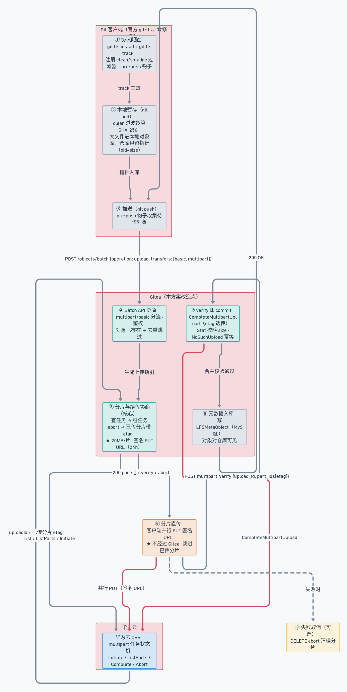

# 分片上传深度解析：从 git push 到华为云 OBS

> **关联文档**：[模型存储与下载加速方案设计](model-storage-acceleration-design.md)（本文是其中 ADR-1/2/3 与 §6.1 上传时序的展开）
> **关联实现**：[openmerlin/gitea@dc8744072](https://github.com/openmerlin/gitea/commit/dc8744072)（Support multipart）、[@97ef16488](https://github.com/openmerlin/gitea/commit/97ef16488)（NoSuchUpload 幂等）
> **信息脱敏说明**：内网 IP、域名以 `<XXX>` 占位，端口、规格、版本、配置项保持真实。

---

## 1. 场景设定

一位模型开发者要把一个 **20GB 的模型权重文件**推送到模型平台：

1. 首次使用时配置一次协议（`git lfs install` + `git lfs track`）；
2. `git add`、`git commit`、`git push`——与普通 git 操作完全一致；
3. 数据最终落到**华为云 OBS**，期间 Gitea 服务端**不承载任何文件字节**；
4. 上传中途网络断开再重试，**已传的分片不用重传**；
5. 全程使用的都是**官方 git-lfs client，零修改**。

本文沿这条链路拆解：每一环**做什么、涉及哪些组件、关键设计考量是什么**。

## 2. 四个"自动"的机制归属（能力视角）

用户视角只有一句话——**"我什么都没做，只是 `git push` 了一下"**。hook、上传、分片、重传全是自动的。本节回答：每一层"自动"由谁提供、我们补了什么设计。第 5 节的 ①~⑨ 环节是这四个"自动"的流程展开。

| 用户看到的 | 谁提供的 | 我们补的设计 |
|---|---|---|
| **自动 hook** | 上游：`git lfs install` 注册 pre-push 钩子 + clean/smudge 过滤器对 | 一个决策：**选择依赖官方 client 机制**，而非 HuggingFace 的 custom-transfer 路线（后者要求用户每个仓库执行 `lfs-enable-largefiles`，做不到零安装） |
| **自动上传** | 上游：pre-push 钩子收集指针 → 发起 batch 请求 | **multipart 协议扩展**（ADR-1）：服务端返回 `parts[]` / `verify` / `abort` 三个动作的指引，客户端照做即可——上传决策权在服务端 |
| **自动分片** | 无（basic 模式是单连接整传） | **ADR-2**：服务端固定 20MB/片 + 每片签名 PUT URL + 大小阈值策略（<100MB 回退 basic，>5GB 强制 multipart） |
| **自动重传** | 无（basic 模式中断即全量重传） | **ADR-3**：状态外置到 OBS multipart 任务 → batch 幂等协商 → 已传且 size 匹配的分片返回 etag → 客户端自动跳过 |

三处最有"设计味"的点：

**① 自动重传是幂等协商的涌现，不是"断点续传功能"（题眼）**

触发链：网络失败 → 客户端重试 batch（协议天然幂等，客户端无任何状态）→ Gitea `ListParts` 查已传 → 只返回未完成分片 → 客户端只补缺失部分。全链路没有新增任何"续传状态"——重传能力从"每次协商都问一遍任务状态"里自然涌现，这正是第 7 节"状态外置"范式的核心。

**② "自动" = 服务端决策、客户端执行——零修改 client 的根本原因**

分片多大、是否分段、哪些片已传，全部由 Gitea 在 batch 响应里决定；官方 client 不需要知道任何新知识，只是忠实地执行协议返回的动作。所有复杂度被收敛到服务端——这是"零安装、零修改"的前提，也是我们和 HuggingFace 路线的分野。

**③ 与 HuggingFace 路线的对比：复杂度推给客户端 vs 收敛到服务端**

同样是解决 >5GB：HF 让用户安装 custom transfer agent（`lfs-enable-largefiles` + `lfs-multipart-upload`，每个仓库都要执行一次，换来更小的响应体积）；我们扩展服务端协议，官方 client 直接可用，换来标准兼容与零安装。

---

## 3. 全链路总览

<div align="center">
<a href="https://whimsical.com/98uDharcatoKyG3ELkrZAw"></a>
<iframe src="https://whimsical.com/embed/98uDharcatoKyG3ELkrZAw" width="100%" height="300" style="border:none;border-radius:8px;" frameborder="0"></iframe>
<p><em>图：分片上传全链路（Whimsical 交互图：点击图片打开 <a href="https://whimsical.com/98uDharcatoKyG3ELkrZAw">Whimsical 在线版</a> 可编辑；GitHub 等不支持 iframe 的平台请直接点击图片）</em></p>
</div>

**图要点**：

- ①②③ 发生在客户端（官方 git-lfs），④⑤⑦⑧ 是 Gitea 的改造点，⑥ 是客户端直传，OBS 的 multipart 任务状态机是"真相源"；
- 红色边是关键数据路径：分片 PUT 直传（⑥→OBS）与合并（⑦→OBS）；
- 断点续传发生在⑤：Gitea 每次协商都问 OBS"已经传了哪些分片"，客户端跳过。

## 4. 组件清单

| 组件 | 归属 | 职责 |
|---|---|---|
| git client | 客户端（上游） | 仓库版本管理；触发 LFS 的过滤器与钩子 |
| git-lfs client | 客户端（上游） | clean/smudge 过滤器、pre-push 钩子、指针文件、transfer adapter（multipart 上传逻辑） |
| `BatchHandlerAdapter` | Gitea（改造） | Batch API 入口分流：声明 multipart 走新链路，否则走原生 basic 链路 |
| `MultipartBatchHandler` | Gitea（改造） | 上传/下载指引生成：鉴权、去重、生成 parts/verify/abort |
| `MultiPartVerifyHandler` | Gitea（改造） | verify 即 commit：触发合并、校验 size、写元数据 |
| `HWCloudStorage` | Gitea（改造） | 华为云 OBS 适配：`GenerateMultipartParts` / `CommitUpload` / 签名 URL |
| OBS multipart 任务 | 华为云 | `InitiateMultipartUpload` / `ListMultipartUploads` / `ListParts` / `CompleteMultipartUpload` / `AbortMultipartUpload` |
| `LFSMetaObject`（MySQL） | Gitea | 对象与仓库的关联元数据（oid、size、repo） |

## 5. 逐环节拆解

### ① 协议配置（一次性）

**做什么**：`git lfs install` 把 LFS 的 clean/smudge 过滤器与 pre-push 钩子注册进 git 配置；`git lfs track "*.bin"` 在仓库写入 `.gitattributes`：

```
*.bin filter=lfs diff=lfs merge=lfs -text
```

**注册了什么**：`.gitattributes` 的四个属性对应 git 的**三个扩展点 + 一个钩子**，由 `git lfs install` 写入 git 配置并挂接：

```
[filter "lfs"]     # 过滤器对：指针 ↔ 真实内容的转换
    clean = git-lfs clean -- %f
    smudge = git-lfs smudge -- %f
    required = true
[diff "lfs"]       # diff 驱动：二进制内容先转可读文本再比较
    textconv = git-lfs textconv
[merge "lfs"]      # merge 驱动：二进制冲突不按文本三路合并
    driver = git-lfs merge %O %A %B
# + .git/hooks/pre-push → git lfs pre-push
```

**工作机制**：

- **`filter=lfs`（clean/smudge 过滤器对）**——git 以 **STDIN → STDOUT** 方式调用这对程序，实现"指针 ↔ 真实内容"的双向转换：
  - **clean（工作区 → 暂存区）**：`git add` 时触发。git 把文件内容交给 `git-lfs clean`，后者边读边算 SHA-256、把实体存进本地对象库 `.git/lfs/objects/{oid}`，STDOUT 只输出**指针文件**（version/oid/size 三行）——**进入 index 的是指针，不是 20GB 实体**；
  - **smudge（暂存区 → 工作区）**：`git checkout`/`clone`/`switch`/`reset --hard` 时触发。git 把仓库里的指针交给 `git-lfs smudge`，后者查本地对象库，没有就向远端发 batch download 拉取，STDOUT 输出真实字节写回工作区；
  - （git 2.11+ 的 `filter-process` 长驻进程协议是同一机制的性能优化，避免每次调用都起进程）；
- **`diff=lfs`**：`git diff` 时先经 `textconv` 把二进制转成可读的指针信息（oid/size）再比较，避免 diff 输出二进制乱码（也可配置为对实体内容做 diff）；
- **`merge=lfs`**：分支合并遇到同一 LFS 文件两边都改过时，不按文本三路合并二进制，而是调 git-lfs 的 merge driver 决定结果（策略可用选项控制，如 ours/theirs），避免合出损坏文件；
- **`-text`**：声明文件是二进制，git 不做行尾转换（CRLF 等），也不按文本方式处理；
- **pre-push 钩子**：`git push` 时 git 先调 `git lfs pre-push`（本地 ref/远端 ref 经 STDIN 传入），git-lfs 比较两端 commit 差异、收集本次 push 涉及的全部 LFS 指针，把对应实体走 batch API 上传（即 ④~⑧ 的 multipart 流程）；上传失败钩子退出非 0，**push 整体中止**。

**git 生命周期 × 扩展点的触发关系**：

| git 操作 | 触发的扩展点 | 方向 | 行为 |
|---|---|---|---|
| `git add` | clean 过滤器 | 工作区 → 暂存区 | 大文件落本地对象库，指针进 index |
| `git commit` | —（不触发任何扩展点） | — | 仅快照 index（此时 index 里已是指针） |
| `git push` | pre-push 钩子 | 本地 → 远端 | 收集指针 → batch API → 实体上传 OBS |
| `git checkout` / `clone` | smudge 过滤器 | 暂存区 → 工作区 | 指针 → 实体还原（本地缺失先下载） |
| `git diff` | diff 驱动（textconv） | — | 二进制转可读文本再比较 |
| `git merge` | merge 驱动 | — | 二进制冲突不按文本合并 |

**组件**：git client + git-lfs client。

**关键考量点**：

- **配置即选路**：`.gitattributes` 决定哪些文件走 LFS 通道（`filter=lfs` 命中即生效，未命中的文件 git 行为完全不变）；
- **零修改的根基**：全部能力（指针替换、diff/merge、上传）都挂接在 git 既有的 filter driver / hook 扩展点上，这是"不改官方 client"的前提；
- **commit 不触发过滤器**（常见误解）：clean 的触发点是 `git add`，`git commit` 只是快照 index——所以仓库历史里永远只有指针，大文件实体存在于本地对象库与远端 OBS；
- **push 的原子性**：实体上传是 push 的一部分，失败即中止，不会出现"指针已在远端、数据缺失"的半成品仓库。

### ② 本地暂存（git add）

**做什么**：clean 过滤器拦截待暂存的文件内容：

1. 流式读取文件，边读边算 **SHA-256**；
2. 内容落盘到本地对象库 `.git/lfs/objects/{oid}`；
3. 向仓库输出**指针文件**（而不是文件本体）：

```
version https://git-lfs.github.com/spec/v1
oid sha256:4d7a214614ab2935c943f9e0ff69d22eadbb8f32b1258daaa5e2ca24d17e2393
size 12345
```

**组件**：git-lfs client（clean 过滤器）。

**关键考量点**：

- **内容寻址（content addressing）**：`oid = sha256(内容)`——同一文件在任意仓库、任意用户之间天然去重，这是整个 LFS 模型的基石，也是服务端"对象已存在就跳过上传"（④）的依据；
- **本地对象库是上传的读取源**：pre-push 时从 `.git/lfs/objects` 读文件，而非从工作区，避免工作区改动影响上传。

### ③ 推送触发（git push）

**做什么**：git push 触发 pre-push 钩子，git-lfs 拦截后收集本次要推送的 LFS 对象清单（oid + size），先于 git 对象推送执行；上传失败则 push 整体中止。

**组件**：git-lfs client（pre-push 钩子）。

**关键考量点**：

- **原子性语义**：LFS 对象上传是 push 的一部分，任一对象失败则用户不会得到一个"指针已在远端、数据缺失"的半成品仓库；
- **批量与并发的起点**：钩子一次性收集全部待传对象，客户端按序/并行逐个走 ④~⑧ 的流程（20GB 文件 = 1 个对象）。

### ④ Batch API 协商

**做什么**：客户端向 Gitea 发起唯一的一次协议请求：

```
POST /objects/batch
{ "operation": "upload",
  "transfers": ["basic", "multipart"],
  "objects": [{ "oid": "...", "size": 21474836480 }] }
```

Gitea 侧 `BatchHandlerAdapter` 看到 `transfers` 含 `multipart`，路由到 `MultipartBatchHandler`；服务端完成三件事：**鉴权**（Basic / `access_token` 方案）、**去重**（对象在 OBS 已存在且元数据在库 → 直接返回"已存在"，客户端跳过整个上传）、**大小校验**（`LFS.MaxFileSize` 限制、oid/size 格式）。

**组件**：Gitea（BatchHandlerAdapter / MultipartBatchHandler）。

**关键考量点**：

- **双通道兼容分流**：同一个 Batch API 同时服务 basic 与 multipart 两种客户端——老客户端/小文件走原生 `BatchHandler`，新能力完全向后兼容（对应挑战 C5：小文件 multipart 是纯开销）；
- **对象级去重是"免费的性能优化"**：内容寻址（②）保证 oid 相同即内容相同，服务端一次 `Exists` 检查即可避免重复上传（实现中为批量 `PointersExists`）；
- **协议锚点单一**：整个上传流程客户端只和服务端协商一次，之后的所有数据流都不再经过 Gitea。

### ⑤ 分片与续传协商（核心）

**做什么**：`MultipartBatchHandler` 调用 `HWCloudStorage.GenerateMultipartParts`，把 OBS 的 multipart 任务状态机当作**唯一真相源**：

1. `ListMultipartUploads`（按对象 key 前缀）：
   - **>1 个未完成任务** → 全部 `AbortMultipartUpload` 后重建（清理脏状态，保证状态一致）；
   - **恰好 1 个任务** → `ListParts` 取已传分片清单——已传且 **size 匹配**的分片直接返回其 `etag`（不带上传 URL），客户端跳过；size 不匹配的分片重新生成上传 URL；
   - **0 个任务** → `InitiateMultipartUpload` 创建新任务；
2. 按 **20MB/片**（`multipart_chunk_size = 20000000`）切分，为每个待传分片生成 OBS **presigned PUT URL**（携带 `partNumber` + `uploadId` 查询参数，默认有效期 **24h**（`default_expire = 86400`））；
3. 响应携带 `parts[]`（href/pos/size/part_id/etag）+ `verify` + `abort` 三个动作。

**组件**：Gitea（HWCloudStorage）+ OBS multipart 任务。

**关键考量点**：

- **状态外置范式**：Gitea 是多实例、无状态的服务，不维护"传到哪里了"——状态活在 OBS 的 multipart 任务里。**续传不是新功能，而是从"每次协商都查一次任务状态"的协议幂等性里自然长出来的**；
- **分片大小的取舍**：20MB/片。太大 → 单分片失败重传代价高、并发粒度粗；太小 → 分片数膨胀（20GB = 1024 片），batch 响应体积和签名 URL 数量线性增长。20MB 与 HuggingFace 的 16MB 量级一致（实践背书）；
- **size 匹配才复用**：分片上传可能因超时/中断导致 OBS 侧落盘不完整，仅凭 partNumber 判断"已传"不可靠，必须校验 size；
- **签名时效 24h 的取舍**：签名 URL 有效期与"超大文件上传耗时 + 重试窗口"匹配；过期只需重新发起一次 batch 协商（⑤ 是幂等的），无需客户端任何状态；
- **授权面最小化**：每个 URL 只能 PUT 该对象的指定分片，客户端全程不接触 AK/SK，无法越权访问其他对象。

### ⑥ 分片直传

**做什么**：客户端拿到 `parts[]` 后**并行** PUT 各分片到签名 URL（已传分片跳过）。数据流是 client → OBS，**完全不经过 Gitea**。

**组件**：git-lfs client（multipart transfer adapter）+ OBS。

**关键考量点**：

- **服务端带宽解放**：Gitea 原生 basic 模式需要流式中转全部字节，改造后 Gitea 只承载 batch/verify 控制面流量——这是 C4（中转瓶颈）的解法，也是平台规模化后 Gitea 实例无需随文件流量扩容的原因；
- **并行度由客户端掌控**：并发分片数是客户端的策略（如 8 并发），服务端通过分片数给出可并行空间，不预设上限；
- **直传的失败语义清晰**：单分片失败只重传该片，其余分片不受影响（对应挑战 C3 的根因消除）。

### ⑦ verify 即 commit

**做什么**：全部分片 PUT 完成后，客户端调用：

```
POST /info/lfs/multipart-verify?oid=<oid>&size=<size>
{ "upload_id": "...",
  "part_ids": [{ "etag": "...", "part_id": 1 }, { "etag": "...", "part_id": 2 }, ...] }
```

Gitea 侧 `MultiPartVerifyHandler` → `CommitUpload` → `CompleteMultipartUpload`（携带每段 etag），合并后 `Stat` 校验 size，最后写 `LFSMetaObject` 入库。

**组件**：Gitea（MultiPartVerifyHandler / HWCloudStorage.CommitUpload）+ OBS。

**关键考量点**：

- **etag 透传是华为云的硬约束**：OBS 合并分片时必须携带每段的 ETag 做合并前校验，而 etag 只有客户端在上传分片时能从响应头拿到——因此协议必须设计 `part_ids[{etag, part_id}]` 的聚合透传结构（即 batch 响应中 `aggregation_params` 声明的语义，这也是与社区规范相比针对华为云的定制点）；
- **幂等设计**：合并时 `NoSuchUpload` 错误被忽略（重复 verify 容忍，[@97ef16488](https://github.com/openmerlin/gitea/commit/97ef16488)）；对象已存在时 verify 直接返回 200——客户端无脑重试即可；
- **合并后仍要校验**：`Stat` 比对 size 兜底"分片缺失/错序"这类合并前校验漏掉的错误，校验不过返回失败，不写元数据；
- **元数据入库是可见性开关**：`LFSMetaObject` 写入后对象才对仓库可见（其他用户 clone 时 batch download 才能命中）。

### ⑧ 元数据入库与完成

**做什么**：`LFSMetaObject`（oid、size、repository）写入 MySQL，Gitea 返回 200，pre-push 继续，push 完成。

**组件**：Gitea + MySQL。

**关键考量点**：

- **元数据与数据分离**：OBS 持有字节，MySQL 持有"谁引用它"的关系——同一对象被多个仓库引用时只需多条元数据记录，数据零冗余（内容寻址的自然延伸）；
- **入库失败的处理**：对象已上传但元数据写入失败时，verify 返回失败让客户端重试，靠 ⑦ 的幂等保证重试不产生脏数据。

### ⑨ 失败取消（可选）

**做什么**：客户端主动放弃时调用 `DELETE multipart-abort`，OBS 侧 `AbortMultipartUpload` 清理未合并分片。

**组件**：git-lfs client + OBS。

**关键考量点**：

- **防止"孤儿分片"**：不取消的话未完成任务的分片会永久占存储计费；⑤ 的"多个脏任务全 abort"策略也是同一治理逻辑；
- **服务端兜底**：即使客户端不调用，下一次协商（⑤）也会清理多余任务，协议自带自愈。

## 6. 关键考量点汇总

| 环节 | 关键考量点 | 对应实现/配置 |
|---|---|---|
| ① 协议配置 | 配置即选路；clean/smudge 过滤器对做指针↔内容转换；diff/merge 驱动避免 git 按文本处理二进制；pre-push 钩子保证 push 原子性；commit 不触发过滤器 | `.gitattributes`、filter/diff/merge 驱动、pre-push 钩子 |
| ② 本地暂存 | 内容寻址（oid=sha256）；本地对象库为上传读取源 | clean 过滤器 |
| ③ 推送触发 | 原子性（对象失败则 push 中止）；批量收集 | pre-push 钩子 |
| ④ Batch 协商 | 双通道兼容分流；对象级去重；单一协议锚点 | `BatchHandlerAdapter`、`PointersExists` |
| ⑤ 分片与续传 | 状态外置到 OBS；脏任务 abort；size 匹配才复用；20MB 分片；签名 24h；授权面最小化 | `GenerateMultipartParts`、`multipart_chunk_size=20000000`、`default_expire=86400` |
| ⑥ 分片直传 | 服务端零中转；并行度由客户端掌控；单片失败语义清晰 | presigned PUT URL |
| ⑦ verify 即 commit | etag 透传（华为云硬约束）；NoSuchUpload 幂等；合并后 Stat 兜底；元数据入库为可见性开关 | `CommitUpload`、`MultiPartVerifyHandler` |
| ⑧ 元数据入库 | 元数据与数据分离；入库失败靠幂等重试 | `LFSMetaObject` |
| ⑨ 失败取消 | 防孤儿分片；协议自愈（下次协商自动清理） | `AbortMultipartUpload` |

## 7. 可迁移的设计范式

1. **状态外置（state externalization）**：无状态服务 + 有状态平台能力（对象存储的 multipart 任务）——把"进度"这种有状态信息交给平台的原生状态机，服务端保持可水平扩展，续传/恢复能力从幂等协商中自然涌现。适用于一切"客户端直传 + 大文件"场景（视频上传、安装包分发、数据集同步）；
2. **内容寻址贯穿**：oid 即内容指纹，去重、幂等、跨仓库复用全部免费获得；
3. **双通道兼容演进**：新协议不替换旧协议，同一入口分流（transfers 声明），老客户端零感知；
4. **能力透明化**：客户端看到的只是"按协议发请求"，复杂的状态管理（脏任务清理、分片复用、合并校验）全部收敛在服务端与云平台之间。

---

## 附录：参考资料

- [Git LFS 规范](https://github.com/git-lfs/git-lfs/blob/main/docs/spec.md) / [Batch API](https://github.com/git-lfs/git-lfs/blob/main/docs/api/batch.md) / [multipart 提议](https://github.com/git-lfs/git-lfs/blob/main/docs/proposals/multipart_transfer_mode.md)
- [Giftless multipart 规范](https://giftless.datopian.com/en/latest/multipart-spec.html)
- [华为云 OBS multipart 上传](https://support.huaweicloud.com/intl/en-us/ugobs-obs/obs_41_0021.html)
- [openmerlin/gitea@dc8744072](https://github.com/openmerlin/gitea/commit/dc8744072)（Support multipart）及 [@97ef16488](https://github.com/openmerlin/gitea/commit/97ef16488)（NoSuchUpload 幂等）
- [模型存储与下载加速方案设计](model-storage-acceleration-design.md)（ADR-1/2/3、§6.1）
